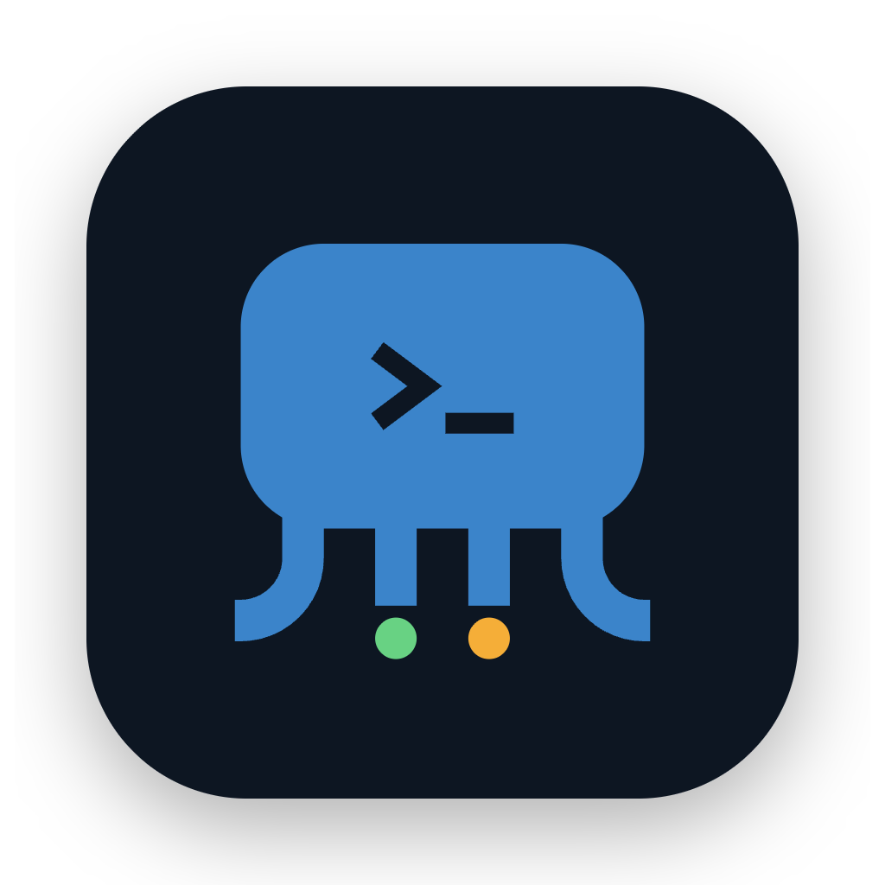
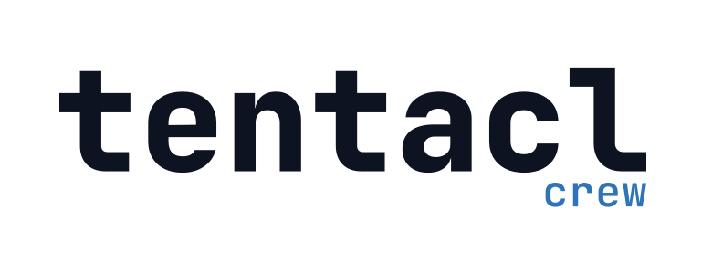
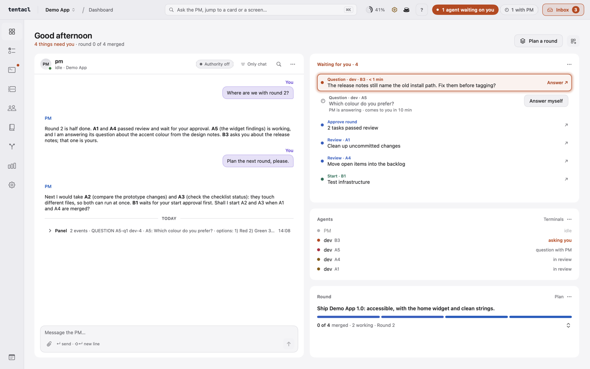
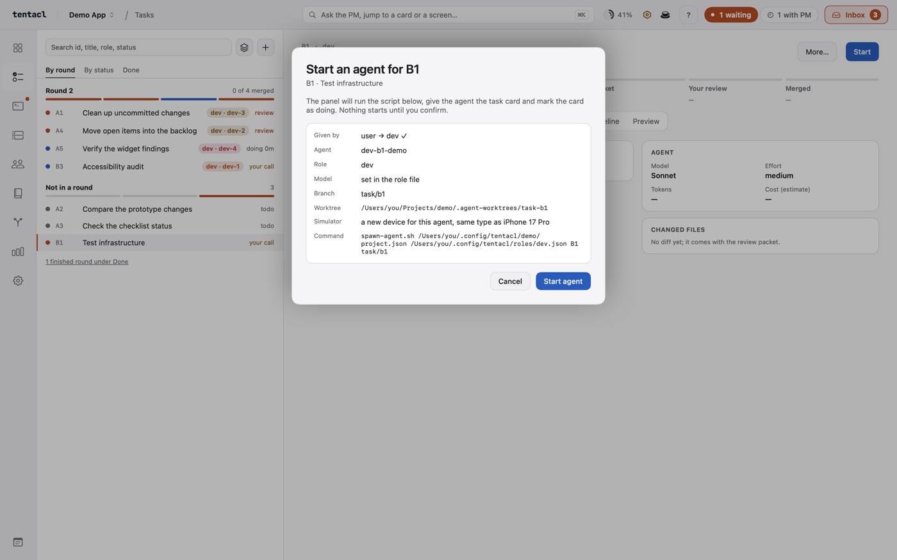
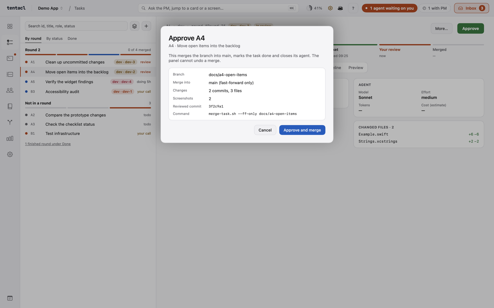
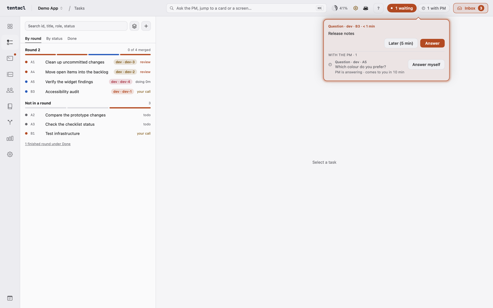
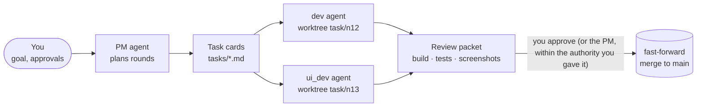

<div align="center">



<picture>
  <source media="(prefers-color-scheme: dark)" srcset="docs/brand/wordmark/tentacl-crew-wordmark-light.png">
  
</picture>

**Run a small team of Claude Code and Codex agents on your project from one Mac app.<br>Nothing merges until you approve it.**

[](https://github.com/kerhun/tentacl-crew/releases)

[](LICENSE)


[Install](#install) · [Quick start](#quick-start) · [How it works](#how-it-works) · [Docs](#docs)

</div>

<picture>
  <source media="(prefers-color-scheme: dark)" srcset="docs/screenshots/dashboard-dark.png">
  
</picture>

Tentacl Crew is a macOS app for running a team of AI coding agents on your own repository. You talk to one **PM agent**. It writes task cards, plans rounds and starts a developer agent per card, each in its own git worktree. The PM runs on Claude Code; each developer role runs on Claude Code or Codex, your choice. When a card is done you get a review packet with the build, the tests and screenshots, and you decide what merges.

## What it does

### One conversation runs the team
The Dashboard puts the PM chat, everything waiting for you, the running agents, today's cost and a live terminal on one screen. You arrange the tiles yourself.

### Nothing runs or merges without you
Before an agent starts you see its role, model, branch, worktree and the exact command. Approving merges fast-forward only. Want less clicking? Give the PM standing authority for the decisions you trust it with.

<table>
  <tr>
    <td><picture><source media="(prefers-color-scheme: dark)" srcset="docs/screenshots/start-sheet-dark.png"></picture></td>
    <td><picture><source media="(prefers-color-scheme: dark)" srcset="docs/screenshots/approve-sheet-dark.png"></picture></td>
  </tr>
</table>

When an agent asks something, a card drops down under the *waiting* pill with Answer, Later and Let the PM decide; questions the PM is already answering are listed below it, with the minutes left before they come to you.

<picture>
  <source media="(prefers-color-scheme: dark)" srcset="docs/screenshots/question-card-dark.png">
  
</picture>

### Watch any agent live
Every agent runs in Tentacl Crew's own terminal. Open the Terminals screen to read along, answer a question or step in.

### Your team, your rules
Pick Claude Code or Codex for each developer role, then its model, effort, permissions and tools, and who reports to whom. Works for any kind of project: an app, a website, a library or plain documents.

| Also included | |
| --- | --- |
| **Plan a round** | The PM picks the next 2–4 cards that don't touch the same files. |
| **Agent questions** | An agent's question arrives as a card; answer it from the panel. |
| **Stats** | Finished tasks per day, time to approval, estimated cost per task. |
| **Several projects** | One inbox per project, notifications that open the right one. |
| **Demo mode** | `Tentacl --demo` opens a sample project with fake agents. |

## How it works



Task cards are plain Markdown files in a data folder outside your repository, so your project history stays clean. Two cards that touch the same file never run side by side.

### How much the PM decides
You choose, per project, in Autopilot rules.

| Setting | What happens |
| --- | --- |
| **Off** | Every agent question comes to you. |
| **Shadow** (default) | The PM suggests an answer on the card; you press it. |
| **On** | The PM answers agent questions and prepares reviews; only what it can't decide comes to you. |
| **PM authority** | The PM may also start and approve cards without asking, up to a daily limit of starts (6 by default). |

Some things always come to you, whatever the setting: pushes, network access, installs, `rm -rf` and `sudo`. Every decision is logged with its reason and cost. The details are in [Using Tentacl Crew](docs/guide.md#pm-autopilot).

## Install
The recommended way: one line installs the latest release into `/Applications`. It checks the download against `SHA256SUMS` and needs no sudo.

```sh
curl -fsSL https://github.com/kerhun/tentacl-crew/releases/latest/download/install.sh | bash
```

**Alternative: Homebrew.** Homebrew asks you to trust every tap outside homebrew/core and homebrew/cask, hence the `brew trust` step.

```sh
brew tap kerhun/tap
brew trust kerhun/tap
brew install --cask tentacl-crew
```

> [!IMPORTANT]
> This beta is not notarized yet. The first time, open System Settings → Privacy & Security and click **Open Anyway**.

Prefer to read the script first? `curl -fsSLO https://github.com/kerhun/tentacl-crew/releases/latest/download/install.sh && less install.sh && bash install.sh`. Updates show up in Settings → Version and updates. Options, uninstall and updates: [Install and update](docs/guide.md#install-and-update).

## Quick start
1. Install [Claude Code](https://github.com/anthropics/claude-code); the PM runs on it. Add [Codex](https://github.com/openai/codex) too if you want developer roles on Codex.
2. Open Tentacl Crew. The Setup checklist shows what is missing. **Sign in** opens `claude auth login` or `codex login` in Tentacl Crew's own terminal.
3. Add a project: pick your repository folder. Tentacl Crew keeps its data next to it, not inside it.
4. Write a goal, press **Start PM**, then **Plan a round**.

> [!NOTE]
> Agents use your own Claude Code and Codex sign-ins and plans. The Dashboard shows your 5-hour and weekly usage so a round doesn't run you out.

## Requirements
- macOS 14 Sonoma or newer
- Claude Code (`claude`), signed in: the PM runs on it
- Codex (`codex`), optional: for developer roles you set to Codex
- `jq` (`brew install jq`)
- git; Xcode only if your project is an Apple app, or to [build Tentacl Crew yourself](docs/building.md)

## Docs

| Page | What's in it |
| --- | --- |
| [Using Tentacl Crew](docs/guide.md) | Every screen, the task card format, `plan.json`, PM autopilot modes, agent questions, projects |
| [Building from source](docs/building.md) | xcodegen, signing, the stable copy, demo mode and snapshots |
| [Scripts](docs/scripts.md) | `spawn-agent.sh`, `request-start.sh`, conflict check, review packet, merge, roles and the team chart |
| [Releasing](docs/releasing.md) | `release-public.sh`, GitHub Release, Homebrew cask |
| [Contributing](CONTRIBUTING.md) | Tests, repository layout, how to send a change |

## License
Tentacl Crew is released under the [MIT License](LICENSE), © 2026 Ibrahim Torus (kerhun). Third-party licenses are in [THIRD_PARTY_NOTICES](THIRD_PARTY_NOTICES). The terminal font menu ships JetBrains Mono and Fira Code (SIL Open Font License 1.1); see [Credits](CONTRIBUTING.md#credits).

The license covers the code. The app name "Tentacl Crew" and its logo and wordmark (`docs/brand/`, the app icon) are not covered: you may not use them to name or brand your own fork or product.
