# Using Tentacl Crew

Tentacl Crew is a local macOS panel, for any kind of software project, that manages a multi-agent development team (one PM agent and three or four developer agents): it lists the task cards, starts an agent per card in its own git worktree, relays your commands, and asks you before anything is merged. Every agent runs in Tentacl Crew's own terminal (its `tentacld` helper); no external terminal is needed, and you work in the agents on the *Terminals* screen.

Script behaviour (what each script checks, writes and refuses) is in [Scripts](scripts.md); building the app is in [Building from source](building.md).

- [Install and update](#install-and-update)
- [First run](#first-run)
- [Your first project](#your-first-project)
- [The screens](#the-screens)
- [Chat with the PM](#chat-with-the-pm)
- [Start, review and approve](#start-review-and-approve)
- [Roles and the Team screen](#roles-and-the-team-screen)
- [Templates and the team chart](#templates-and-the-team-chart)
- [Agent questions](#agent-questions)
- [PM autopilot](#pm-autopilot)
- [Projects](#projects)

## Install and update
**Install (no build).** One line installs the latest Tentacl Crew into `/Applications` (or `~/Applications` if that is not writable):
```sh
curl -fsSL https://github.com/kerhun/tentacl-crew/releases/latest/download/install.sh | bash
```
Or download, read, then run it: `curl -fsSLO https://github.com/kerhun/tentacl-crew/releases/latest/download/install.sh && less install.sh && bash install.sh`. Options: `--version v1.0-beta.1`, `--dir DIR`, `--yes`, `--uninstall` (`--purge` also removes your settings and data after listing and asking). It checks the download against `SHA256SUMS` and the app's signature, and needs no sudo. The build is ad hoc signed: open Tentacl Crew from Applications; if macOS says it cannot verify the app, go to System Settings → Privacy & Security → *Open Anyway*.

**Homebrew.** `brew install --cask kerhun/tap/tentacl-crew` (same ad hoc signed build; `brew uninstall --cask --zap tentacl-crew` also removes settings and data). Open it once via System Settings → Privacy & Security → *Open Anyway*.

**Updates.** Settings → *Version and updates* checks GitHub Releases (at launch and every 24 h; *Check now* too) and offers *Install update*, which runs that release's `install.sh` after a confirm and reopens the app. (For maintainers: every public release needs a new tag, see [Releasing](releasing.md).)

**Try it without a project.** `Tentacl --demo` opens the app with the sample project in `app/Demo/` and fake agents.

## First run
Tentacl Crew opens a *Setup* checklist by itself on the first launch, and again whenever something required is missing; it is also in Settings → *Setup check…*. Each line shows ✓ (fine), ✗ (missing) or ! (cannot tell) and, for ✗, the fix: a command to copy (nothing is installed or run for you) or a button.
1. The terminal answers (the bundled `tentacld` helper is started if it is not running)
2. `claude` installed, and Claude Code signed in (checked with `claude auth status`); when a role uses Codex, `codex` and its sign-in too
3. `jq` installed (`brew install jq`)
4. Scripts folder set (*Choose scripts folder…* checks it has the scripts and saves `scriptsDir`)
5. At least one project (*Add project…*)
6. The shared `dev` and `pm` roles (*Add … from templates*)
7. The project folder is trusted by Claude Code (the command to copy)

*Re-check* runs everything again. The terminal, claude, jq, the scripts folder, a project and the roles are the required items; sign-in and trust are shown but do not reopen the guide.

<picture>
  <source media="(prefers-color-scheme: dark)" srcset="screenshots/setup-dark.png">
  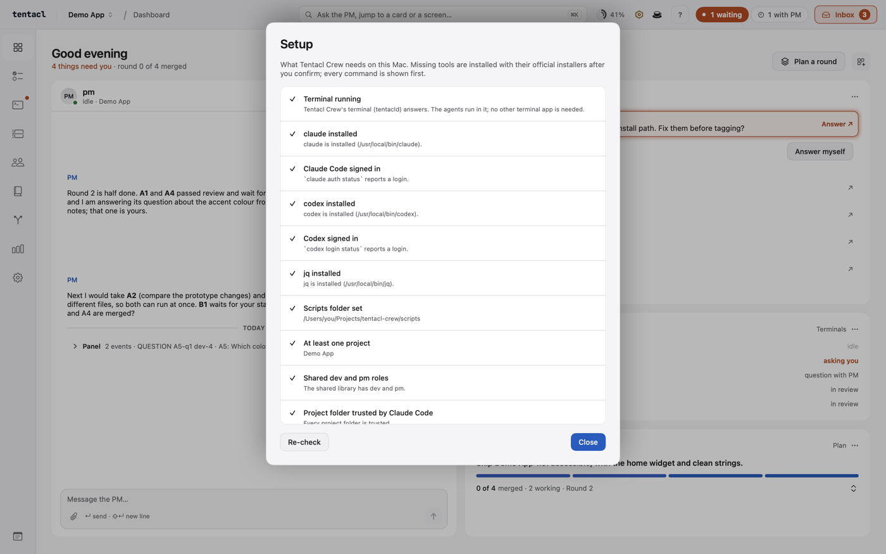
</picture>

## Your first project
1. Copy [`examples/project.minimal.example.json`](../examples/project.minimal.example.json) (or [`project.example.json`](../examples/project.example.json) for an iOS app) to your own data folder, edit it, and check it: `scripts/validate-config.sh /path/to/project.json`.
2. Create `~/.config/tentacl/projects.json` with `{ "projects": ["/path/to/project.json"], "scriptsDir": "/abs/path/to/agent-panel/scripts" }`. (Or leave it out and use *Add project* in the top bar.)
3. Put task cards (see [`examples/task-card.example.md`](../examples/task-card.example.md)) in the `tasks/` folder next to `project.json`.
4. Open `claude` once in the project folder and trust it, then start the app, pick a `todo` card and press *Start agent*.

Examples: [`examples/`](../examples) holds a full and a minimal `project.json`, a `team.json` (the team chart), role files (`roles/`) and a task card.

**Project data is not kept in the app's repository.** Backlog, task cards and real configuration files (including personal paths) live in your own data folder, outside the repository. Only example files are committed.

## The screens
Screenshots are taken from a live window that shows the real screens with demo data, in light and dark (`docs/screenshots/generate.sh`, see [`screenshots/README.md`](screenshots/README.md)); nothing is hand-made.

The left rail has eight screens: Dashboard, Tasks, Timeline, Team, Plan, Git, Stats and Settings (⌘1 to ⌘8 in that order). A new install opens on the Dashboard; afterwards the window reopens on the last screen.

**Dashboard.** Talk to the PM and follow the work in one place. A strip at the top shows the PM's standing authority (*x of y today*; click it to change it in the Autopilot rules), today's cost against the daily limit, and *Plan a round* (same rule as on the Tasks screen; when it is disabled the reason is shown next to it). Below it, three columns that wrap on a narrow window: the goal (`goal.md`) and the current round with done/total (`plan.json`), then *Waiting for you* with every decision and its usual buttons (its count is the top bar's *waiting for you*: every entry but *Approve round*, which only bundles the reviews listed below it) (Approve round, a waiting round, agent questions, escalated fixes, cards to review, start approvals); in the middle *Chat*, the conversation with the project's PM (*Start PM* / *Stop PM* above it; always addressed to the PM; quick prompts *status*, *plan the next round*, *what failed today* fill the message box and never send by themselves); on the right the agents (each task agent as a card with its task, a six-step bar, the last action, time and today's cost, and *Nudge to continue* when it seems stuck) and the history. The autopilot pill and plan usage sit in the top bar, on every screen. When the PM replies while you are on another screen, the Dashboard's rail icon gets a dot. The panel watches every project in `projects.json` at once (one inbox and one autopilot each); the project menu shows how many agents wait for you in each, and notifications name the project and open it.

**Agents and Chat on the Dashboard.** These used to be tabs and live on the Dashboard now (the Tasks screen has no right column). *Agents*: the agents of running tasks, each with *Open terminal* (opens its card on the Terminals screen) and *Stop* (asks first); the header counts agents waiting on you or the PM. *Chat*: whether a PM session runs (*Start PM* / *Stop PM*; Stop asks first) and the conversation. Questions, fix cards and a *Round waiting* card are in *Waiting for you*; the autopilot pill is in the top bar.

<picture>
  <source media="(prefers-color-scheme: dark)" srcset="screenshots/dashboard-dark.png">
  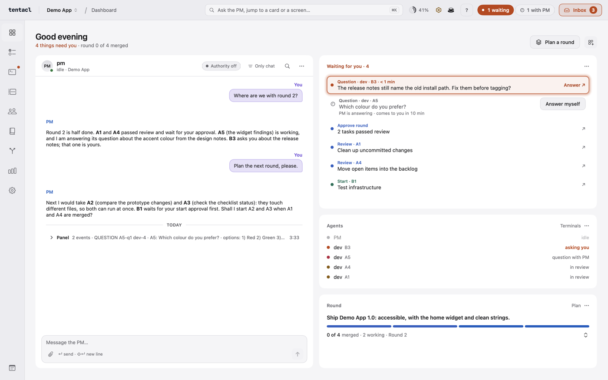
</picture>
<picture>
  <source media="(prefers-color-scheme: dark)" srcset="screenshots/questions-dark.png">
  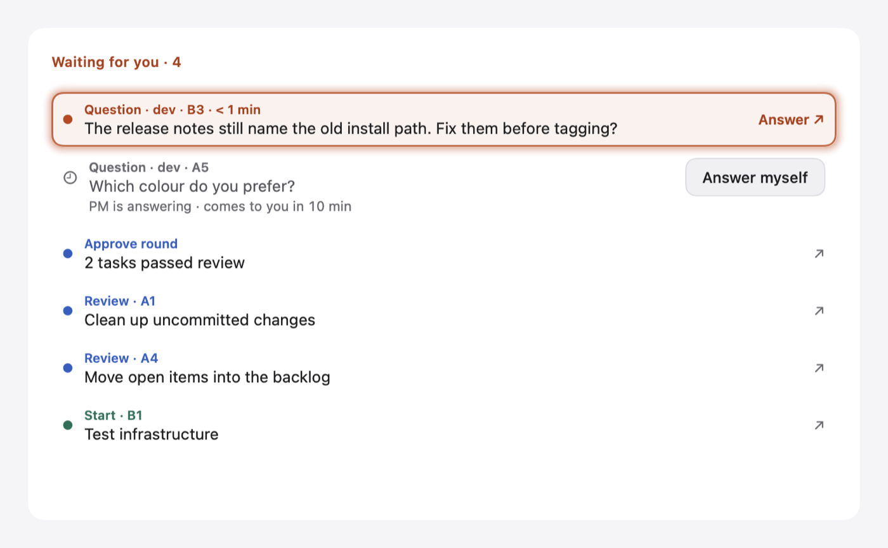
</picture>

**Tasks.** Two columns: the list and the task detail, which takes the rest of the width. Left: the task list for the selected project, with a *New task* button, *Plan a round* and a search box (id, title, role, status). Cards are grouped by what needs you first (*Needs your decision*, doing, backlog, blocked); *Done* and *Cancelled* are collapsed unless you open them or search. Arrow keys move through the list. Each row shows a **phase** chip for a card with an agent: *Starting*, *Working*, *Waiting for you*, *PM handling*, *Finished* (the agent wrote its Report; next is *Prepare review*), *Idle*, *Blocked*, *In review*, *Needs fix*. A card whose dependencies are not done shows what it waits for and cannot be started.

<picture>
  <source media="(prefers-color-scheme: dark)" srcset="screenshots/tasks-dark.png">
  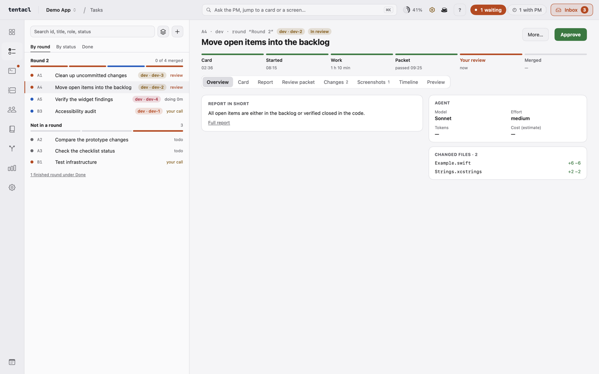
</picture>

**Task detail.** The right column has six tabs: *Card* (every section of the card), *Review packet*, *Report* (rendered Markdown), *Changes*, *Timeline* (what happened to the card: starts, questions, the PM's decisions) and *Agent screen* (the agent's terminal, read only while this tab is open). Under it the Command box talks to the agent; when *Prepare review* fails because the agent's worktree has unsaved work, *Ask the agent to commit* asks the agent to commit it. *Edit* opens the card in the same form as *New task*, and a card that is not running can be set back to todo, blocked or cancelled there.

**New task.** Writes `tasks/<id>.md` with status `todo` and `from: user`: id prefix (the next number is chosen for you), title, Goal, Scope, Acceptance, `files:`, branch, dependencies, role, kind (task or analysis) and **priority** (high, normal, low; the PM prefers high cards when it plans a round). You start the card from the list like any other. The card format is shown in [`examples/task-card.example.md`](../examples/task-card.example.md).

**Start sheet.** What a start will do (role, model, branch, worktree, the exact command) before anything runs.

<picture>
  <source media="(prefers-color-scheme: dark)" srcset="screenshots/start-sheet-dark.png">
  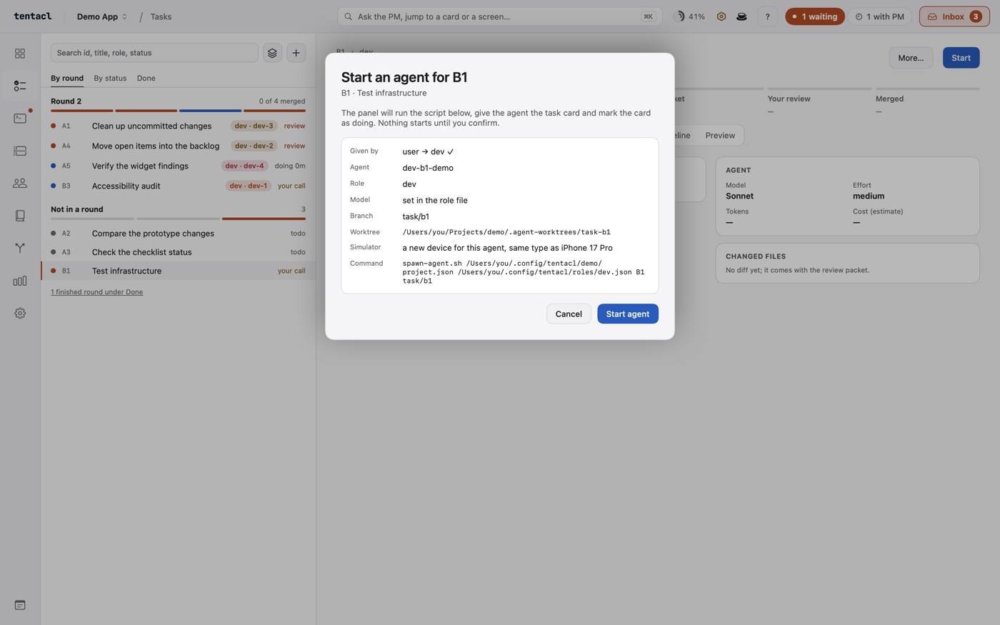
</picture>

**Approve.** Branch, commits, files, screenshots and the reviewed commit; *Approve and merge* is a fast-forward only.

<picture>
  <source media="(prefers-color-scheme: dark)" srcset="screenshots/approve-sheet-dark.png">
  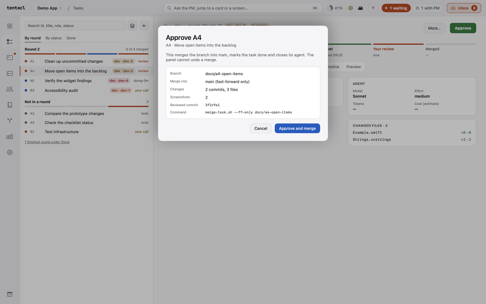
</picture>

**PM autopilot.** The PM answers what it can; the Autopilot rules sheet sets what it may decide. What each mode allows is listed under [PM autopilot](#pm-autopilot) below.

<picture>
  <source media="(prefers-color-scheme: dark)" srcset="screenshots/autopilot-dark.png">
  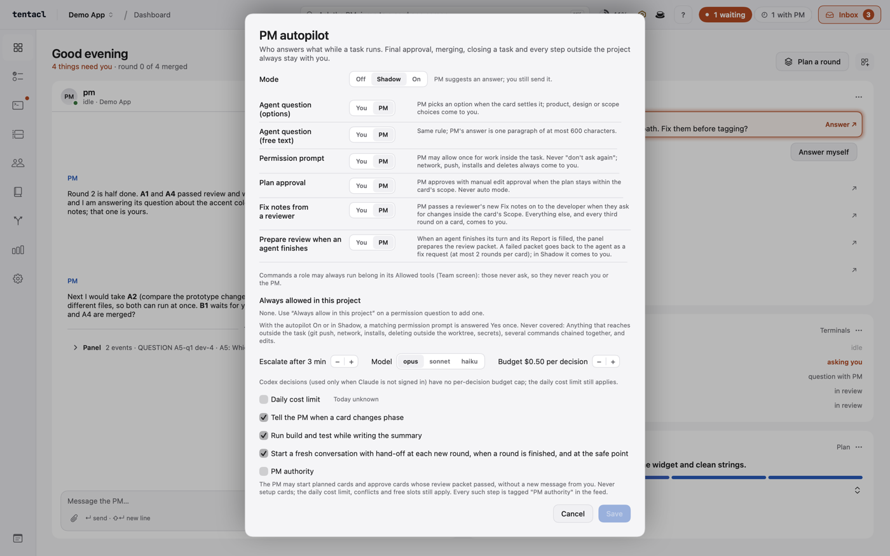
</picture>

**Plan a round.** The sheet first asks *What matters for this round?* (optional; kept until you change it), then the PM picks the next 2 to 4 cards; you untick and start.

<picture>
  <source media="(prefers-color-scheme: dark)" srcset="screenshots/round-dark.png">
  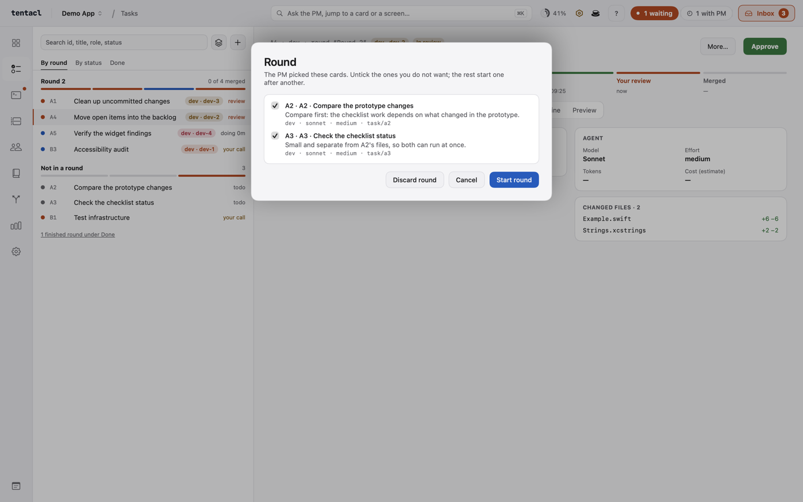
</picture>

**Team: roles and chart.** Model, effort, permissions, tools and skills per role; who reports to whom.

<picture>
  <source media="(prefers-color-scheme: dark)" srcset="screenshots/team-dark.png">
  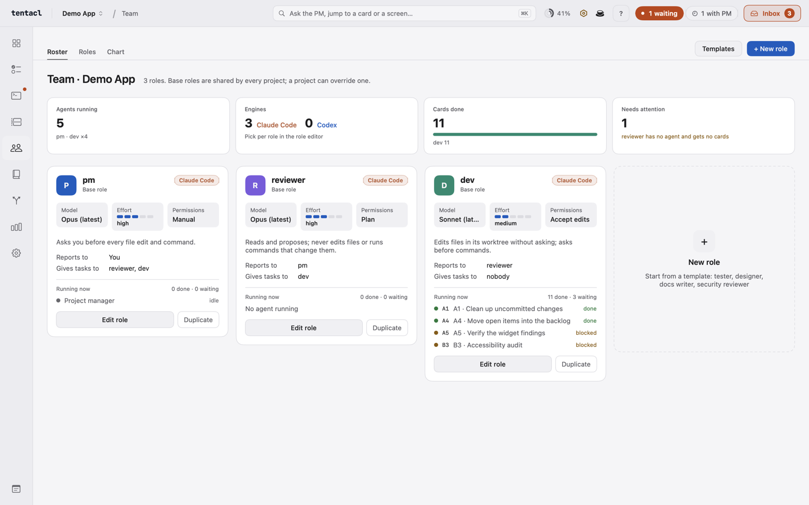
</picture>
<picture>
  <source media="(prefers-color-scheme: dark)" srcset="screenshots/team-chart-dark.png">
  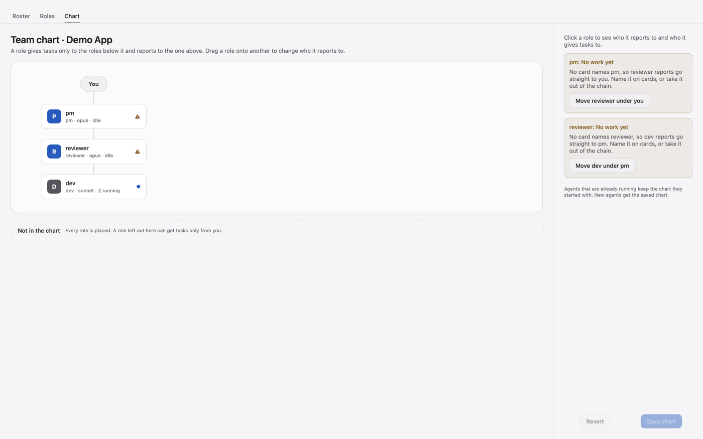
</picture>

**Plan.** The project's goal and the PM's plan. *Goal*: one text you write and save in the app (`goal.md` in the project's data folder); the PM is told when it changes. *Waiting for you*: rounds the PM marked `waiting` and its open questions. *Rounds*: each with its reason, done/total progress and its cards, with *needs … / blocked by … / blocks …* on each row; a row opens the card on the Tasks screen. A missing or unreadable `plan.json` shows a hint, never an error.

### plan.json (the PM writes it, next to `tasks/` in the data folder)
```json
{
  "rounds": [
    { "name": "Round 1", "cards": ["N1", "N2"], "reason": "one line: why these cards, why now", "status": "running" },
    { "name": "Round 2", "cards": ["N3"], "reason": "needs Round 1", "status": "waiting" }
  ],
  "questions": ["Open question that needs the user's decision"]
}
```
`name` is required; `cards` (card ids), `reason` and `status` are optional. `status` is free text; `waiting` puts the round under *Waiting for you*. Progress is done cards out of the round's cards (cancelled cards are left out). The goal is not in this file: it is the user's `goal.md`.

**Stats.** Tasks by status, finished per day, time from start to approval, and an **estimated cost** per finished task, per day and in total (agent sessions plus PM decisions, from token counts at list prices: an estimate, not a bill).

<picture>
  <source media="(prefers-color-scheme: dark)" srcset="screenshots/stats-dark.png">
  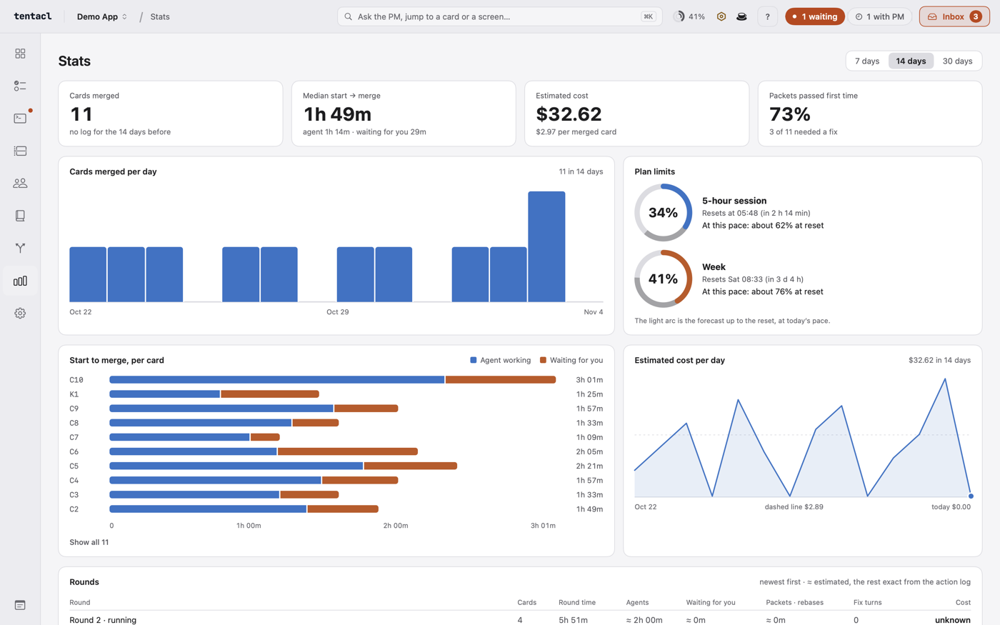
</picture>

**Settings.** The scripts folder and settings file (with any problem found in them), the signing hint, a switch for notifications, and the stable version. *Update stable…* builds the chosen tag and installs it as the stable Tentacl Crew (a sheet shows the exact command first), *Relaunch now* then restarts the panel from the new copy, and *Clean up…* lists agents and worktrees whose card is not running and removes them after you confirm (work that is uncommitted or not merged is listed but kept).

<picture>
  <source media="(prefers-color-scheme: dark)" srcset="screenshots/settings-dark.png">
  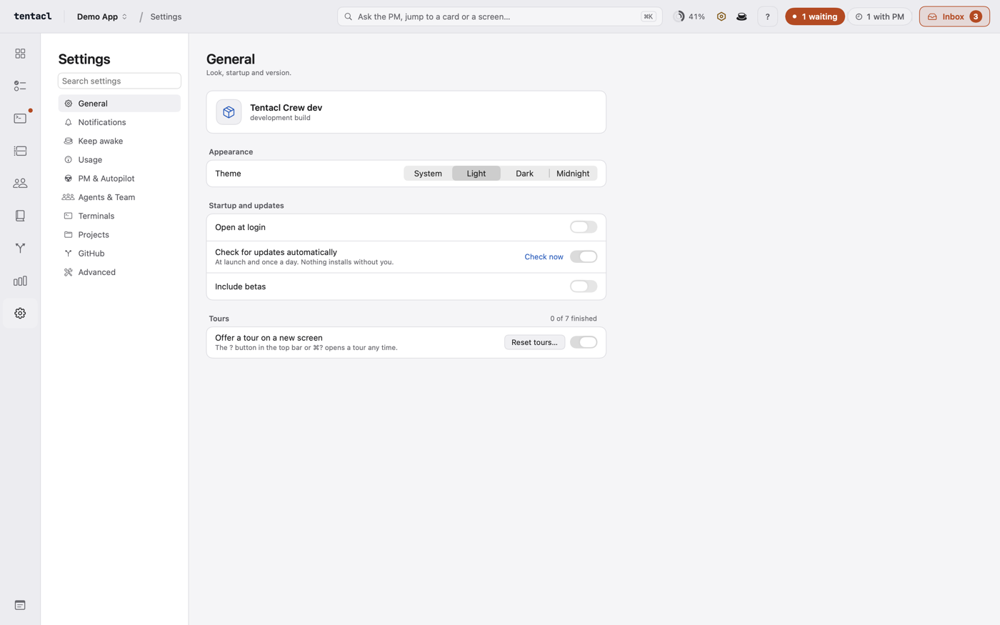
</picture>

**Add project.** A new project or an existing folder (see [Projects](#projects)).

<picture>
  <source media="(prefers-color-scheme: dark)" srcset="screenshots/add-project-dark.png">
  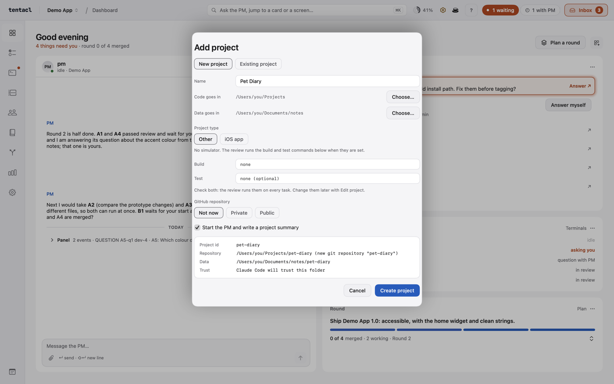
</picture>

## Chat with the PM
With `scriptsDir` and a `dev` role configured (see [Scripts → Settings](scripts.md#settings)) the panel can send messages and start agents, both after your explicit action. Without `scriptsDir` the panel stays read-only.

**Send a message to the PM** (the Dashboard's *Chat*; ⌘↵ sends). The panel checks that the agent is still running right before sending.

The box is also a conversation with that agent: above the input the thread shows your messages (right), the agent's replies (left, Markdown, long ones cut with *Show all*, each with *Copy*) and its tool use as one grey line ("ran 4 commands, edited 2 files"). It is read from the agent's Claude session file (`~/.claude/projects/<working directory with every character other than letters, digits and "-" turned into "-">/<session id>.jsonl`, the session id comes from the agent's hook state); the panel never writes to it. A blue dot next to *Command* means the agent replied while the panel was not in front. Script output and errors stay in the status line under the input, not in the thread.

**Images.** Paste (⌘V) or drop images (PNG, JPEG, HEIC, GIF, at most 10 MB each) on the box, or press the paperclip; they show as thumbnails above the input with an × to remove each. On *Send* the panel copies each one to `~/Library/Application Support/Tentacl/attachments/<project id>/<date>-<random>.<ext>` (pasted images as PNG) and adds one `[Image: /absolute/path]` line per image to the message, which Claude Code reads. Nothing is written into the project or a worktree. Every agent can read the attachments folder without a permission prompt (see [`spawn-agent.sh`](scripts.md#starting-agents)). The thread shows those lines as thumbnails (click for a larger preview); a path you typed yourself stays text. Attachments older than 30 days are deleted when the panel starts. A file that is too large or not an image is refused with a message under the input.

## Start, review and approve
- **Start a task**: select a card that is `todo` or `awaiting-start-approval`, press *Start agent*, read the confirmation sheet (agent, role and model, branch, worktree, simulator, the exact command) and confirm. The panel runs `spawn-agent.sh`, hands the agent its card and marks the card `doing`. If any step fails, the agent, its worktree, simulator and fresh branch are removed again. Before the first start in a project, open `claude` once in that project and trust the folder (agents run in worktrees inside the project); the start sheet also offers it, see [Claude Code's trust question](scripts.md#claude-codes-trust-question).
- **Prepare review** (a task that is `doing`, `needs-fix` or `review`): the panel runs `review-packet.sh`, which builds the app on the agent's own simulator, takes a screenshot and summarises the diff. Only a complete packet moves the card to `review`.
- **Approve** (a task in `review`): the sheet lists the branch, what it merges into, the number of commits and files, the screenshots and the reviewed commit. *Approve and merge* runs `merge-task.sh`, marks the card `done` (with a `## Decision` note) and closes the agent, its worktree and its branch. Analysis tasks (`kind: analysis`) change nothing: approving only marks the card done and closes the agent.
- **Request fix**: your note is appended to the card's `## Fix notes`, the card becomes `needs-fix` and the agent is asked to work on it. When the main branch has moved on, a fix request that asks the agent to rebase is filled in for you.
- **Close task**: a task that is doing, needs a fix or is in review but whose agent or worktree is gone (the card has no agent or branch, or the worktree folder no longer exists) shows a *Close task* button. After a confirmation it marks the card **cancelled** (its own status and its own *Cancelled* section in the list, not done) with a `## Decision` note "Cancelled … closed without merge"; nothing is run and nothing is deleted.

How the merge protects your work, and what the panel writes into cards, is in [Scripts → Review, approve and fix](scripts.md#review-approve-and-fix).

## Roles and the Team screen
The *Team* screen (the people icon in the left rail) edits the roles agents run with: model, effort, permission mode, kind, allowed tools, the skills the role may use, instructions, a display name, and extra Claude settings. Where role files live and how a start uses them is in [Scripts → Roles](scripts.md#roles-and-agent-settings).

- **The card picks the role.** `roles: [reviewer]` in a card's front matter starts that role (the first one; no `roles` means `dev`). A missing role stops the start and the message lists where it looked. Only interactive roles can be started.
- **Names.** A role's name is lowercase letters, digits and `_` (at most 20), because agents are called `<role>-<task>`. The optional display name ("Atlas") is only shown on screen: in the agent list as `Atlas · T1`, in the task header and in the start sheet. It never reaches a script, a path or a command. Agents you start yourself (your PM session) are not tied to a card and keep their own label.
- **Skills.** The list shows your skills (`~/.claude/skills`) and the plugins Claude knows about. Everything not ticked is switched off for that agent. A plugin is on or off as a whole.
- **Advanced.** Extra Claude settings as JSON, merged into the agent's settings file; the form's own fields (model, permission mode, and the skills list for `enabledPlugins`/`skillOverrides`) win on a clash. `env` is rejected, in the form and by `validate-config.sh`: do not put secrets in role files, define them in your terminal.
- **Preview.** *What will be started* shows exactly what a start uses (see [`spawn-agent.sh --print-flags`](scripts.md#roles-and-agent-settings)), and which of your other Claude settings (permissions, hooks, MCP servers) still apply, by name and count only, never by value.

## Templates and the team chart
- **Templates.** *+ New role* first asks where the role lives (shared or only in this project), then offers ready-made members: **PM** (Opus, high, `manual`, Read+Bash), **Developer** (Sonnet, `acceptEdits`), **Reviewer** (Opus, high, plan mode), **UI developer**, **Analyst** (read-only, writes a report) and an empty form. A template only fills the form; the saved role carries no link to it, and you can change anything first. The instructions of a template say what the job is and how to report, never who the manager is (the chart adds that).
- **The team chart** (the *Chart* tab of the Team screen): you are at the top. A role may give tasks only to the roles below it; roles at the same level, or above, cannot. The rule follows the chart, not the role's name: put a developer above the PM and the PM does that developer's tasks. *Create the default chart* builds you → pm → reviewer → dev and ui_dev from the roles that exist. The file format and checks are in [Scripts → The team chart](scripts.md#the-team-chart).
- **`from` on a card.** `from: reviewer` says who gave the task; no `from` means you. When a project has a chart, planning a start checks it for the card's **first** role. Not allowed: *Start agent* is off, the sheet says why (`Given by`), and **I am giving this task myself** starts it anyway and writes `from: user` on the card (you are at the top of the chart). `from` is the card's own claim: your confirmation is the real gate, so nothing starts silently.
- **Deleting a role** that is in the chart also removes it from the chart (its reports move up to its manager) and asks first.
- **Limits.** Agents that are already running keep the chart they started with. The panel does not watch what agents write to each other: a reviewer's findings go into the card's *Fix notes* and reach the developer through the existing *Request fix* action.

## Agent questions
When an agent of a running task asks you something, a **Needs your answer** card appears in the Dashboard's *Waiting for you* (orange: it waits for you), the task row gets an *asks* chip and the top bar counts it in *waiting for you*.
- **Multiple choice** (an agent that is blocked on a menu, such as Claude's question tool): the card shows the question and one button per option; pressing one presses that option's number key in the agent (verified with a real agent: the key selects at once, no Enter). Options the panel cannot answer with one key ("Type something", "Chat about this") are not offered: use the agent's terminal for those.
- **A plain question** (the agent finished its turn with a message that ends in "?"): the card has an answer box; *Send* gives the agent your text as a prompt.
- **Skip** tells the agent to carry on without an answer (Escape closes a menu; a plain question gets a short instruction to continue with its best judgment and note the assumption). **Dismiss** only hides the card: the agent keeps waiting, and the card comes back only if the agent asks again. The answer goes only to the same agent session: if the pane was closed or reused, nothing is sent and the card says so.
- The panel reads an agent's screen (from tentacld) only when its state changed, only for agents that belong to a running task (not your own PM session), and only presses digits, `enter`, `esc`, `up` and `down`. A structured channel through Claude hooks is not part of this first version.
- **Permission and plan cards.** "Needs your permission" shows what the agent wants to do (a command, a fetch, an edit) with *Allow once* and *Deny* (Escape); a "don't ask again" option appears as a separate red-outlined button with a warning, because it grants the permission for good. "Needs your approval" shows an agent's plan with *Approve* buttons; asking for changes still happens in the agent's terminal. These cards have no *Skip*: allowing and denying are decisions.
- **The floating question card.** Away from the Dashboard, a question for you drops a card down under the *waiting* pill in the top bar, with a soft glow around it: *Answer*, *Later* and, when the PM has a suggestion, *Let the PM decide*. Questions the PM is answering are listed under it, muted, with the minutes left before they come to you and *Answer myself*. The pill opens and closes it; Esc closes it until a new question comes.

<picture>
  <source media="(prefers-color-scheme: dark)" srcset="screenshots/question-card-dark.png">
  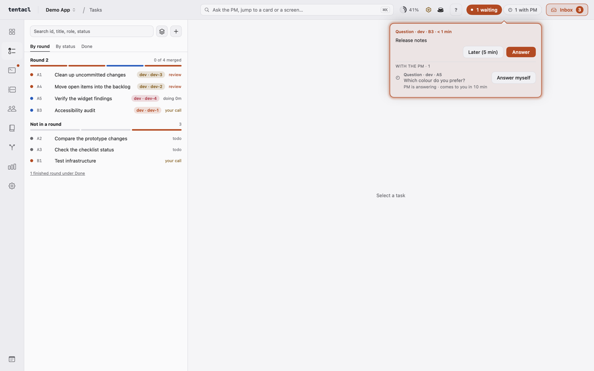
</picture>

## PM autopilot
The **PM autopilot** switch is the pill in the top bar. It sends the questions above to the PM instead of to you, so you do not have to look after each agent while a task runs. Exactly what each mode allows:
- **Off**: nothing is decided for you. Every question comes to you.
- **Shadow** (the default): the PM only suggests. Nothing is sent, started, prepared or merged without your click.
- **On**: the panel sends the PM's answers to questions, permission prompts (allow once only) and plans; passes a reviewer's fix notes on; **prepares the review packet by itself** when an agent finishes (a failed packet goes back to the agent as a fix request, at most 2 rounds per card); starts the cards you asked the PM for, and, when you asked the PM in the Command box to approve a card (*Approvals you ask the PM for*, below), runs *Prepare review* and **merges it** (fast-forward only, card `done`, agent closed). It never approves or merges a card on its own: only a request that your own Command box message backs, within 10 minutes. Closing or cancelling a task, anything outside the project (push, network, installs, `rm -rf`, `sudo`) and every escalation stay with you. Switching to On asks for confirmation.
- **Modes.** *Off*: every question comes to you, as before. *Shadow* (the default): the PM writes its suggestion on the card ("PM suggests 2: …" with a one-line reason, the option outlined in blue) and you still press it. *On*: the PM's answer is sent; only escalations come to you, with the PM's suggestion already on the card.
- **How the PM decides.** One short `claude --print` call per question: no tools, no saved session, no user settings or MCP servers, a JSON schema the answer must match and `--max-budget-usd` per call. The PM reads the task card and the earlier decisions on that card. It never writes to an agent: the panel sends its answer through the same path as yours (same agent session, question re-read from the screen right before sending).
- **What the panel enforces, whatever the PM says.** Permission prompts that reach outside the task (push, network, fetch, installs, `rm -rf`, `sudo`…) skip the PM. The PM may only *allow once*, never "don't ask again" and never deny (a refusal comes to you). A plan may only be approved with manual edit approval, never auto mode. A typed answer is at most 600 characters. An answer that breaks a rule, a "low confidence" answer, a failed call, or no decision within the time limit (3 minutes by default) comes to you.
- **Rules** (the switch's menu, *Autopilot rules…*): who answers each kind of question (you or the PM), the time limit, the model (default `opus`) and the budget per decision. Commands a role may always run belong in that role's *Allowed tools* (Team screen): they never ask, so they never reach the PM.
- **Where it is kept.** Per project in `~/Library/Application Support/Tentacl/autopilot/`: `<project>.json` for the rules (outside the project, so no agent can change them) and `<project>.decisions.jsonl` for every decision (PM's and yours, with the reason and cost). The PM tab lists today's decisions and what the PM is deciding now; an agent the PM is handling shows *PM handling* instead of waiting on you.
- **Fix notes from a reviewer.** When a reviewer agent writes a new entry into the `## Fix notes` of a card that is doing, needs a fix or is in review, the PM reads it (card, the entry, earlier decisions) and either passes it on or escalates. Passing on is only for notes that ask for changes inside the card's Scope; the panel then sends the usual fix request to the same agent (the card moves to `needs-fix`, the prompt points at the newest Fix notes entry, nothing is appended again). In *on* it is sent; in *shadow* the card in the PM tab says "PM suggests passing this fix on" with a *Send fix request* button. The row **Fix notes from a reviewer** in the rules (default PM) decides who handles it; *Off* or "You" leaves it all to you. The panel's own writes (your *Request fix*) are never treated as a reviewer's note, and notes already on a card when the panel starts are not new. The PM passes on at most **2 fix rounds per card** (counted from the decision log); the third round, every PM escalation, a failed call or a failed send comes to you as an orange card with the reason. Each step is a decision of kind `fix` in the feed.
- **Plan a round.** With the autopilot on or in shadow mode, the *Plan a round* button above the task list asks first *What matters for this round?* (your note goes to the PM), then which 2 to 4 `todo` cards to run next (it sees each card's Goal, Dependencies, `files:` and `priority:`; it prefers high-priority cards). The panel then checks the answer itself: only existing `todo` cards whose dependencies are done, no two cards sharing a file (`scripts/check-conflicts.sh`), and no more than the project's `maxParallel` minus the agents already running. The *Round* sheet lists the accepted cards with the PM's reason and each start plan (role, model, branch), and says why any card was left out. Untick what you do not want and press *Start round*: the cards start one after another through the normal start flow, each with its own rollback; if one fails, the rest are not started and the sheet says which card failed. The round appears in the decision feed as one decision.
- **Starts you ask the PM for.** When you write "start N18 and N19" in the Dashboard's Chat, the PM can ask the panel to do it with `request-start.sh` (file format in [Scripts → Requests from the PM](scripts.md#requests-from-the-pm)). The panel checks every card with its normal start rules (status `todo` or `awaiting-start-approval`, dependencies done, role and team chart, `maxParallel`, shared files, folder trust, rollback of a failed start). With the autopilot **on**, and only when a message you sent from the Command box in the last 10 minutes contains the quoted words (one message backs one request), the accepted cards start at once, one after another, and the first failure stops the rest. In *shadow* or *off*, or when the panel did not see you ask, nothing starts: the *Round* sheet opens with the accepted cards ticked and one click starts them. Cards that cannot start (running, blocked, done, unknown, over the limit) are refused with the reason. The PM gets the result as a prompt in its pane (starting with "Panel:"); each request is a decision of kind `start` in the feed and a `start-request` line in `actions.log`. A request waits while the Round sheet is already in use.
- **Approvals you ask the PM for.** The same way for "approve N18", with `request-approve.sh`. The panel accepts only cards that are `doing`, `needs-fix` or `review`. With the autopilot **on**, and only when a message you sent from the Command box in the last 10 minutes contains the quoted words (one message backs one request), the panel runs its own *Prepare review* and, when the packet is complete, its own *Approve* (merge, card `done`, agent closed; analysis cards are not merged), card by card; a failed approve stops the rest. A card whose packet fails is never approved: the PM gets the reason as a "Panel:" prompt and can send a fix request. In *shadow* or *off*, or when the panel did not see you ask, nothing is prepared or merged: the *Approve* sheet opens for the first card. Each request is a decision of kind `approve` in the feed and an `approve-request` line in `actions.log`. A request waits while the panel is busy or an Approve sheet is open.
- **PM authority (standing).** Off by default; switch it on per project in *Autopilot rules* (*PM authority*, with *starts a day*, default 6). When on, the PM's start and approve requests work without a message from you (words the PM does pass are still recorded): the panel starts or approves through its normal flow. The panel enforces the limits, not the PM: at most the daily number of starts (counted from the feed, so a restart keeps it), approve only when the review packet passed (build, screenshots, head, branch not behind the main branch) and the card does not need a fix (open Fix notes), never a card with `kind: setup`, nothing once the daily cost limit is reached, and the usual conflict, role, dependency and `maxParallel` checks. A request over a limit is refused with the reason (no sheet). Every step is tagged *PM authority* in the decision feed and in `actions.log`, and the PM's pane gets the usual "Panel:" answer. The authority works only for requests that carry the PM's session key (see [Scripts → Session key](scripts.md#session-key)); a request with no key or a wrong key is judged as if the authority were off (your words and the 10-minute rule), and a wrong key is also logged as a warning in `actions.log` and the decision feed. When it is off, nothing changes, including the 10-minute Command box rule.
- **Phase notices.** When a card changes phase (finished, needs fix, blocked…), the panel tells the PM's pane in one batched "Panel:" prompt, only while the PM is idle. The rule *Tell the PM when a card changes phase* in the autopilot rules turns it off.

## Projects
Tentacl Crew is not tied to iOS. The `project.json` keys (which are required, which turn a capability on) are listed in [Scripts → project.json](scripts.md#projectjson).

**Add project** (project picker, top bar) has two paths:
- *New project*: type a name ("Pet Diary"); the id, repository folder, git repository and data folder are named `pet-diary` in the folders you choose (they default to the places of your first project). `scripts/create-project.sh` makes the repository and the data folder ([details](scripts.md#create-projectsh)). Presets: *Other* (no build, no simulator) and *iOS app* (simulator, Xcode project name and build command; the first task creates the Xcode project).
- *Existing project*: pick the project's folder (the top of a git repository with at least one commit). Its name, main branch and Xcode project are detected; the repository itself is not changed. Only the data folder is created. (`spawn-agent.sh` already keeps `.agent-worktrees/` out of git with the local `.git/info/exclude`.)

**GitHub repository.** The form can ask for a private or public GitHub repository. The panel never creates it: it writes a task card `G1 · Create the GitHub repository` (role `pm`, visibility written out) and you start it like any task. The project manager runs `gh repo create` and reports the URL; for a public repository it first looks for secrets, and without a logged-in `gh` it stops and says so.

**Edit project** (also in the picker) changes the name, parallel agents, build or test command, main branch, Xcode project, simulator, opener, screenshots and shared files; saving checks the file with `validate-config.sh` first and keeps keys the panel does not know. *Remove from list* only takes the project off `projects.json`; no file is deleted.
